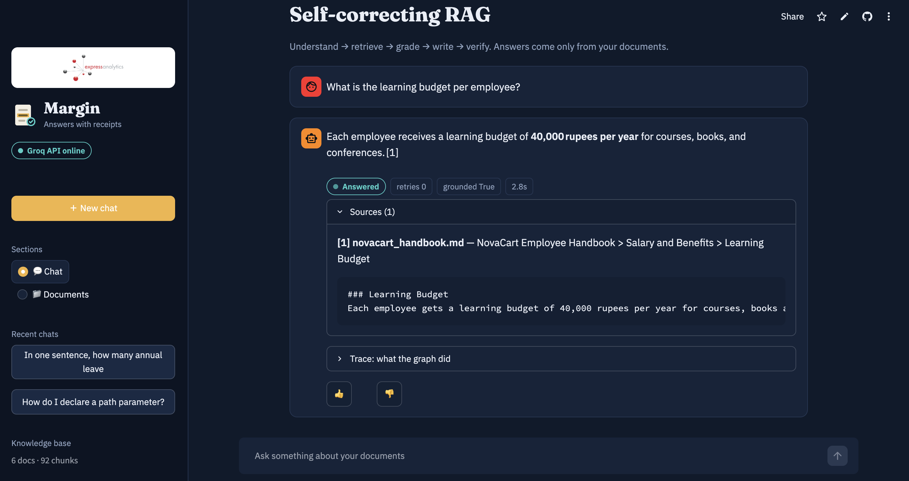
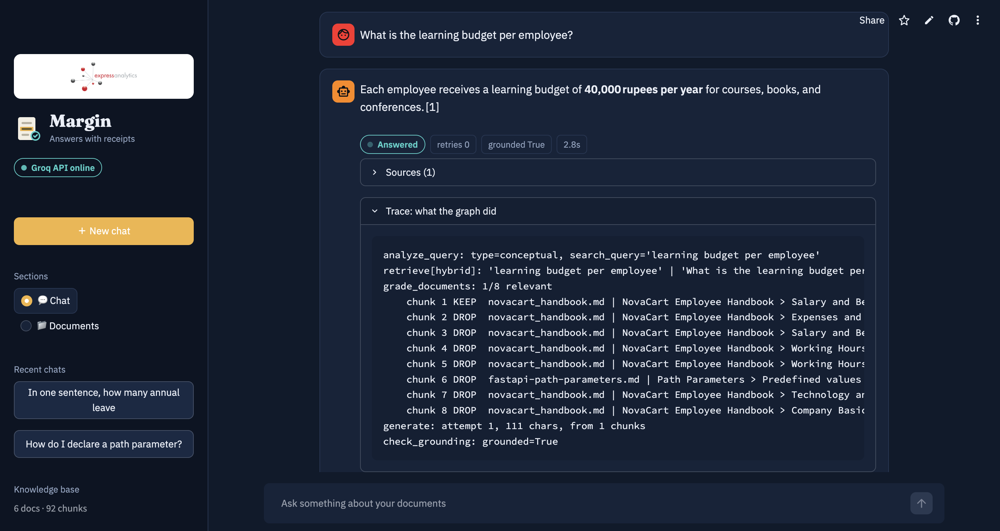
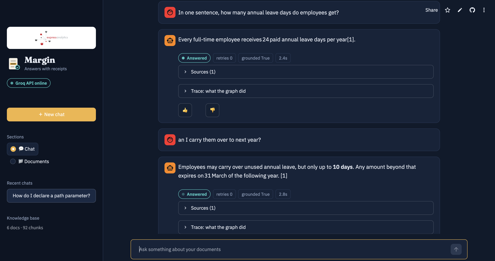
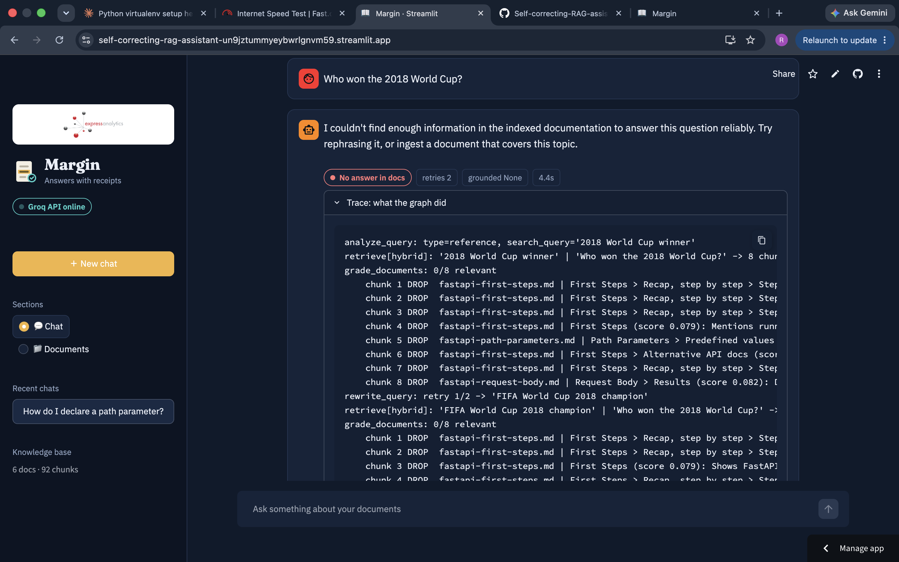
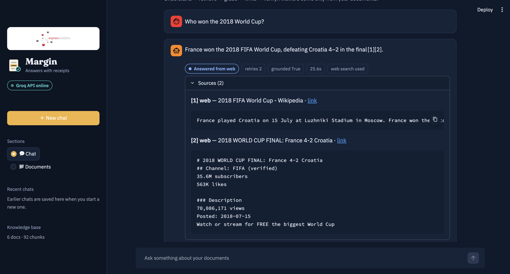
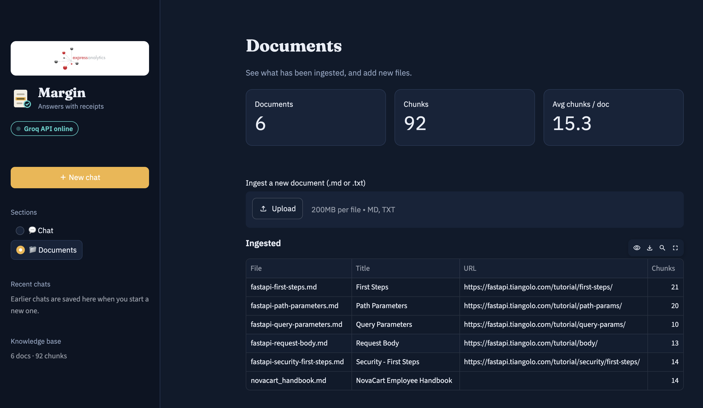
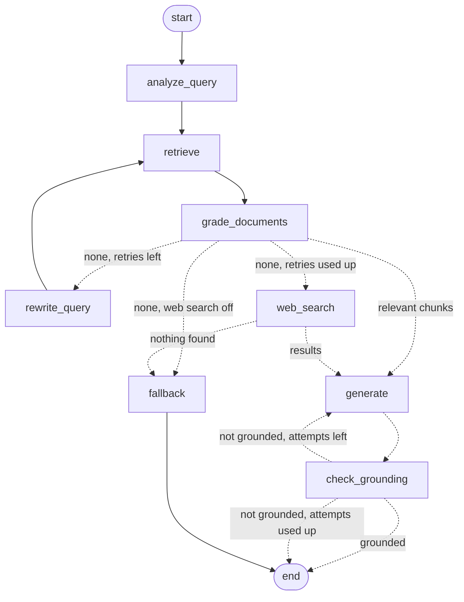

# Self-Correcting RAG Assistant

A question-answering assistant that **checks its own work**. It retrieves chunks from your documents, grades whether they are relevant, rewrites the query and tries again when they are not, then falls back to web search, and says *"I don't know"* instead of guessing. After writing an answer it verifies that every claim is backed by the sources.

**Live demo:** https://self-correcting-rag-assistant-un9jztummyeybwrlgnvm59.streamlit.app/

> The demo is a public instance: uploads are disabled and each session is limited to a few questions. It may take about a minute to wake up after being idle. Questions the documents cannot answer are sent to web search.

Built with **LangGraph**, **FastAPI**, **ChromaDB**, **Groq**, **Tavily** and **Streamlit**.

## Screenshots

| Answer with citations and sources | Trace of what the graph did |
|---|---|
|  |  |

| Conversation memory (follow-up question) | Honest "I don't know" after retries |
|---|---|
|  |  |

| Web search fallback | Documents page |
|---|---|
|  |  |

## What it does

- **Ingestion:** loads `.md` / `.txt` files, splits them into heading-aware and code-aware chunks, embeds them and stores them in ChromaDB. Re-ingesting a file replaces its old chunks, so there are no duplicates.
- **Self-correcting workflow (LangGraph):** query analysis → retrieval → relevance grading → generation. If no chunk is relevant, the query is rewritten and retrieval is repeated, up to a retry limit. After that it falls back to web search, or to an honest "I don't know" when web search is off or finds nothing.
- **Web search fallback:** when the documents do not cover a question, Tavily results are used as context and the answer is clearly marked `answered_from_web`, with the web links as sources.
- **Hallucination check:** a grounding judge verifies the answer against the retrieved chunks. Unsupported answers are regenerated, otherwise flagged as `unverified`.
- **Conversation memory:** follow-up questions ("Can I carry them over to next year?") are rewritten into standalone questions using the session history.
- **REST API (FastAPI):** `POST /query`, `POST /ingest`, `GET /documents`, `POST /feedback`.
- **UI (Streamlit, "Margin"):** chat, sources with snippets, the full execution trace, feedback buttons and a documents page.

## Architecture



You can print the exact compiled graph with `python -m scripts.ask --graph`.

| Node | What it does |
|---|---|
| `analyze_query` | Uses the chat history to turn the question into a standalone question and a search query. |
| `retrieve` | Hybrid search: dense vectors and BM25, merged with Reciprocal Rank Fusion. |
| `grade_documents` | One LLM call grades all candidate chunks for relevance and keeps the useful ones. |
| `rewrite_query` | Rewrites the search query when nothing relevant was found. |
| `web_search` | Tavily fallback when the documents do not cover the question (optional). |
| `generate` | Writes the answer with `[n]` citations, using only the kept chunks. |
| `check_grounding` | Verifies that the claims in the answer are supported by the chunks. |
| `fallback` | Returns "I don't know" instead of a guess. |

### Response status

| `status` | Meaning |
|---|---|
| `answered` | Answer written from the documents and verified as grounded. |
| `answered_from_web` | The documents had nothing, so the answer comes from web search. |
| `unverified` | Answer written, but the grounding check could not confirm it. |
| `no_answer` | Nothing relevant found. The assistant says it does not know. |

## Project structure

```
app/
  main.py         FastAPI app and endpoints
  graph.py        LangGraph workflow and routing
  nodes.py        Graph nodes (analyze, retrieve, grade, generate, ...)
  state.py        Graph state (TypedDict)
  prompts.py      All LLM prompts
  retrieval.py    Hybrid dense + BM25 retrieval with RRF
  ingest.py       Loading, chunking, embedding, storing
  vectorstore.py  ChromaDB wrapper
  llm.py          Groq client and embeddings
  db.py           SQLite storage for feedback
  config.py       Settings (environment variables)
  schemas.py      Request and response models
scripts/          fetch_docs, ask (CLI), check_setup, inspect_chunks, ...
tests/            84 tests (API, graph routing, ingestion, retrieval)
data/docs/        Sample corpus (FastAPI docs + a fictional company handbook)
docs/             Screenshots used in this README
ui.py             Streamlit UI
```

## Setup

**Requirements:** Python 3.11 and a free [Groq API key](https://console.groq.com/). A free [Tavily API key](https://tavily.com/) is optional and enables web search.

```bash
git clone https://github.com/rehaan052/Self-correcting-RAG-assistant.git
cd Self-correcting-RAG-assistant

python3.11 -m venv .venv
source .venv/bin/activate
pip install -r requirements.txt

cp .env.example .env        # then put your GROQ_API_KEY in .env
python -m scripts.check_setup
```

### Configuration (`.env`)

| Variable | Default | Purpose |
|---|---|---|
| `GROQ_API_KEY` | none | Required. |
| `GROQ_MODEL` | `openai/gpt-oss-120b` | Chat model. Kept in `.env` because hosted models get retired. |
| `EMBEDDING_MODEL` | `sentence-transformers/all-MiniLM-L6-v2` | Runs locally on CPU. |
| `TAVILY_API_KEY` | empty | Enables the web-search fallback. |
| `ENABLE_WEB_SEARCH` | `true` | Needs a Tavily key to do anything. |
| `ENABLE_HALLUCINATION_CHECK` | `true` | Turns the grounding check on or off. |

Chunk size, overlap, `top_k` and the retrieval constants are set in `app/config.py`.

### Run it

```bash
# 1. Get the sample documents (FastAPI docs) into data/docs
python -m scripts.fetch_docs

# 2. Chunk, embed and store every .md file in data/docs
python -m app.ingest

# 3. Start the API
python -m uvicorn app.main:app --reload

# 4. In another terminal: start the UI
python -m streamlit run ui.py
```

Or ask from the command line: `python -m scripts.ask "How do I declare a path parameter?"`.

### Run the tests

```bash
pip install -r requirements-dev.txt
python -m pytest -q        # 84 passed
```

The tests use a scripted fake LLM, so they run in a few seconds, need no API key and cover every routing path (retry, web search, fallback, regeneration).

## API

Interactive docs are at `http://127.0.0.1:8000/docs`.

**Ask a question**
```bash
curl -X POST http://127.0.0.1:8000/query \
  -H "Content-Type: application/json" \
  -d '{"question": "How do I declare a path parameter?"}'
```
Pass the returned `session_id` in the next request to continue the conversation.
```json
{
  "query_id": "…",
  "session_id": "…",
  "answer": "… [1]",
  "status": "answered",
  "grounded": true,
  "retries": 0,
  "used_web_search": false,
  "sources": [{"id": 1, "source": "…", "section": "…", "url": "…", "score": 0.61, "snippet": "…"}],
  "trace": ["analyze_query: ok", "retrieve[hybrid]: 8 chunks", "grade_documents: 3/8 relevant", "generate: done"]
}
```

**Ingest a document** (`.md` or `.txt`, max 1 MB)
```bash
curl -X POST http://127.0.0.1:8000/ingest -F "file=@my_notes.md"
```

**List documents**
```bash
curl http://127.0.0.1:8000/documents
```

**Send feedback**
```bash
curl -X POST http://127.0.0.1:8000/feedback \
  -H "Content-Type: application/json" \
  -d '{"query_id": "<query_id from /query>", "rating": "up", "comment": "helpful"}'
```

| Code | When |
|---|---|
| 422 | Invalid request body |
| 400 | Unsupported file type or empty file |
| 404 | Unknown `query_id` in feedback |
| 413 | File larger than 1 MB |
| 502 | The LLM or pipeline failed |

## Thought process

The goal was an assistant that knows when it does not know. A plain "retrieve and answer" pipeline always answers, even when the retrieved text is irrelevant, which is where hallucinations come from. So the workflow adds checks: the question is analysed (and made standalone using the chat history), retrieved chunks are graded for relevance, a failed retrieval triggers a query rewrite and a retry, and only after the retries are used up does the system try web search or say "I don't know". After generation, a grounding check verifies the answer against the sources. LangGraph fits this well because the retry and routing logic is an explicit graph with conditional edges, so every path can be tested and every run produces a readable trace.

## Chunking and embedding strategy

- **Chunking:** heading-aware first (every chunk stays inside one topic and carries its section path), then size-based with overlap inside a section. Code blocks are kept whole where possible and re-wrapped in a fence when a large block must be split. Tiny stub chunks are merged into the next related chunk.
- **Embedding:** `sentence-transformers/all-MiniLM-L6-v2`, run locally on CPU, so no embedding API key or cost is needed. The embedded text is the heading path plus the prose with code removed, while the stored chunk keeps the original text.
- **Retrieval:** dense search and BM25 are fused with Reciprocal Rank Fusion, using both the standalone question and the rewritten search query.
- Chunk size, overlap, minimum chunk size and top-k are configurable in `app/config.py`.

## Assumptions

- The corpus is a set of Markdown or plain-text files. The sample corpus is five FastAPI documentation pages plus a fictional company handbook (NovaCart), so that both a technical and a policy-style question can be tested.
- The documents are in English and small enough for a local vector store (ChromaDB). There is no multi-user authentication.
- A hosted LLM (Groq) is acceptable for generation, grading and verification, while embeddings run locally.
- Chat sessions only need to live as long as the API process. Feedback is stored in SQLite.
- Web search is optional and requires a Tavily key. Without a key, the assistant answers "I don't know" when the documents have nothing.

## Design decisions

These came from measuring the pipeline on the sample corpus, not from guessing.

- **Code-aware, heading-aware chunking.** Documents are split on headings first, so every chunk stays inside one topic and carries its section path (for example `Path Parameters > Predefined values`). Inside a section, text is split with overlap, short code blocks are kept whole, and oversized code blocks are split on line boundaries with every piece re-wrapped in a fence so each chunk is valid code on its own.
- **Stub chunks are merged.** A heading with one or two lines has almost no content, but the embedding model ranked such stubs in the top 2 while the real answer chunk sat at rank 10 to 18. Chunks under a minimum size are merged into the next related chunk.
- **Embedding text differs from stored text.** The vector is built from the heading breadcrumb plus the prose with code blocks removed (code diluted the embedding: the score of the right chunk rose from 0.29 to 0.45 after removal). The store still keeps the original text, with code, for grading and generation.
- **Hybrid retrieval, not vectors alone.** Dense embeddings rank short or code-heavy chunks too high and miss exact terms such as function and parameter names. BM25 (with a light stemmer and stop-word list, over section title plus text) catches exact words. The two ranked lists are merged with Reciprocal Rank Fusion, which needs no score normalisation.
- **Multi-query retrieval.** The standalone question and the search query are both searched and all rankings are fused together, which makes follow-up questions work.
- **Idempotent ingestion.** A file's old chunks are deleted before it is stored again, and chunk ids are content hashes, so re-ingesting never creates duplicates.
- **One grading call per query.** All candidate chunks are graded in a single structured LLM call instead of one call per chunk. This keeps latency and rate-limit usage low. The grader also returns a one-line reason per chunk, which is shown in the trace.
- **Web search only after the documents fail.** The assistant tries the rewrite loop first and uses the web only when retries are used up, so questions the documents can answer never leave the knowledge base. Web answers are labelled and cite their links.
- **Fail-open judges.** If the analyzer, grader or grounding judge fails (bad JSON, rate limit), the pipeline continues with safe defaults instead of returning a 500. Only generation itself is allowed to fail the request.
- **Structured output with a fallback.** The helper tries `json_schema` first and falls back to function calling, because model support differs.
- **Bounded loops.** Both the query-rewrite loop and the regeneration loop are capped, so the graph always terminates.
- **Model name lives in `.env`.** The original model (`llama-3.3-70b`) was retired on Groq during development, so swapping a model should not need a code change.
- **Deployment without a second server.** On Streamlit Cloud the UI runs the FastAPI app in the same process through an in-memory ASGI client, so the demo uses the real endpoints and validation without a separate backend.

## Trade-offs and limitations

- **Latency and cost.** A normal question takes about 4 LLM calls (analyze, grade, generate, grounding check). A fallback path can take about 6, and a web answer adds a Tavily request. This is the price of self-correction. On the free Groq tier, bursts of questions can hit rate limits.
- **Grading depends on retrieval.** The grader can only keep what retrieval finds. If the right chunk is not in the candidates, rewriting helps, but it is not a guarantee.
- **Web results are less controlled.** Web answers come from search snippets, so their quality depends on the sources Tavily returns. They are always labelled `answered_from_web`.
- **Small embedding model.** `all-MiniLM-L6-v2` is light and fast on CPU, but a larger model would retrieve better on bigger collections.
- **BM25 index is rebuilt in memory.** It is rebuilt whenever the stored chunks change, which is fine for a small corpus but would need a real search index at scale.
- **State is in memory.** Chat sessions live in the API process and are lost on restart. The vector store and feedback persist locally (`chroma_db/`, `feedback.db`).
- **Public demo is ephemeral and shared.** The hosted app rebuilds its vector store on a cold start, sleeps when idle, enforces a soft per-session question limit, and shares one free Tavily quota across all visitors. If the quota runs out, it falls back to "I don't know".

## Possible improvements

- A cross-encoder re-ranker after hybrid retrieval.
- Streaming tokens from the API (the UI currently animates a finished answer).
- Persistent sessions (SQLite or Redis) and authentication.
- PDF and HTML ingestion.
- Use the collected 👍/👎 feedback to evaluate and tune retrieval.
- A retrieval and answer-quality evaluation set (Ragas or similar).
- Docker image and CI that runs the tests on every push.

## Tech stack

Python 3.11 · LangGraph · LangChain · FastAPI · ChromaDB · sentence-transformers · rank-bm25 · Groq (`openai/gpt-oss-120b`) · Tavily · SQLite · Streamlit

## License

MIT, see [LICENSE](LICENSE).